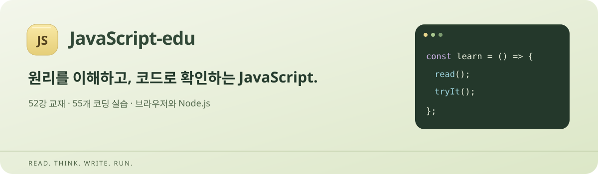
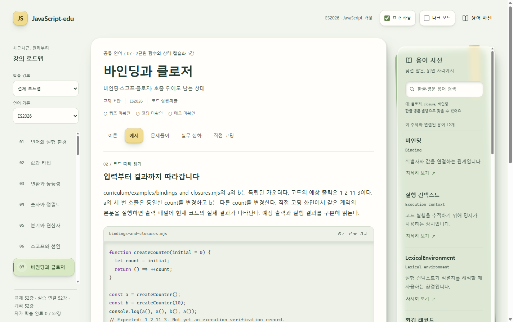

<div align="center">



# JavaScript-edu

**원리를 이해하고, 코드로 확인하는 JavaScript.**

다른 언어 경험자의 JavaScript 전환 학습부터 현직 개발자의 브라우저·Node.js 심화까지.

[](docs/roadmap.md) [](docs/roadmap.md) [](curriculum/exercises.json) [](docs/project-state.md) [](https://github.com/jbsim999/JS-edu/actions/workflows/scaffold-check.yml?query=branch%3Amain)

[교육 로드맵](docs/roadmap.md) · [개발 소스](https://github.com/jbsim999/JS-edu/tree/main) · [기여 안내](CONTRIBUTING.md) · [버그·제안](https://github.com/jbsim999/JS-edu/issues)

</div>

## 소개

JavaScript-edu는 **한국어 웹 교재와 로컬 코드 실행·자동 채점을 함께 제공하는 학습 앱**입니다. “같은 객체를 복사했는데 왜 원본이 바뀔까?”, “함수 호출이 끝난 뒤에도 값은 어떻게 남아 있을까?” 같은 질문을 코드를 바꾸고 실행하며 확인합니다.

수업은 **이론 → 예시 → 문제풀이 → 실무 심화 → 직접 코딩**으로 이어집니다. ECMAScript 언어 규칙과 브라우저·Node.js API를 나누어 설명하고, 공식 자료의 출처와 실제 실행 환경을 함께 제공합니다.

> **개발 상태** — 52강·55실습과 코드 문법 색상, 용어 사전, 진도 저장을 구현했습니다. Windows 0.1.0은 사용자 실행 확인을 마쳤습니다. 0.1.1 프리뷰는 코드 테마와 Mac 패키징을 추가하며 Windows·Mac Apple Silicon 네이티브 CI를 통과했습니다. Mac Intel은 패키징 검사기의 진단 문구를 보완하고 있습니다. 공개 다운로드 릴리스는 아직 게시하지 않았습니다. [현재 상태](docs/project-state.md)

## 시작하기

### 데스크톱 앱

전달받은 ZIP은 **폴더 전체를 압축 해제**해 사용하세요. Electron과 Node.js 전체 런타임이 포함되므로 따로 설치하거나 시스템 경로를 설정할 필요가 없습니다.

| 환경 | 선택할 파일 | 실행 방법 |
| --- | --- | --- |
| Windows x64 | `JavaScript-edu-<버전>-win-x64.zip` | `JavaScript-edu.exe` 실행 |
| Mac · Apple Silicon | `JavaScript-edu-<버전>-mac-arm64.zip` | `JavaScript-edu.app` 실행 |
| Mac · Intel | `JavaScript-edu-<버전>-mac-x64.zip` | 최종 검증 중. 완료 상태 확인 후 사용 |

1. 앱을 열고 수업과 학습 단계를 선택합니다.
2. 예시를 읽고 **직접 코딩**에서 코드를 작성합니다.
3. **실행**으로 결과를 확인하고 **제출**로 행동 검사를 받습니다. Node.js 실습은 첫 실행 동의가 필요합니다.

Windows는 x64용이며, Mac은 **macOS 13.5 이상**과 해당 CPU를 대상으로 합니다. 실행 파일이나 앱 내부 파일을 따로 옮기지 마세요. 미서명 프리뷰로 Developer ID 서명·공증 및 인터넷 다운로드 후 Gatekeeper 검증은 완료하지 않았습니다. [패키징 안내와 검증 범위](docs/packaging.md)

### 개발 소스로 바로 학습하기

Node.js 22 이상이 필요합니다. 외부 npm 의존성이 없어 별도의 패키지 설치 없이 시작합니다.

```sh
git clone --branch main https://github.com/jbsim999/JS-edu.git
cd JS-edu
npm run dev
```

브라우저에서 [로컬 학습 화면](http://127.0.0.1:4179/)을 엽니다. 서버는 이 PC에서만 접근합니다. Node.js 실습까지 실행하려면 **정확히 Node.js 24.22.0**으로 서버를 시작하거나 아래 실행 파일 경로를 지정합니다.

```powershell
# 설치한 공식 배포본 경로로 변경하세요. 시스템 PATH는 바꾸지 않습니다.
$env:JS_EDU_NODE_EXECUTABLE = 'C:\tools\node-v24.22.0-win-x64\node.exe'
npm run dev
```

버전이 다르거나 실행 파일이 없으면 화면에 이유를 표시합니다. 교재·퀴즈·코드 편집은 계속 사용할 수 있습니다. [고정 Node 공급자와 체크섬](runtime/node-vendor.json)

## 학습실 미리보기



*0.1.1 Windows 검증용 앱에서 캡처한 실제 화면입니다. 밝은 테마·다크 모드를 제공하며, 화면 캡처와 플랫폼별 실행 검증은 구분합니다.*

## 주요 기능

| 기능 | 학습 경험 |
| --- | --- |
| 원리부터 실무까지 | 값·참조·스코프·클로저부터 비동기 처리와 호스트별 프로젝트까지 학습 |
| 다섯 단계 수업 | 개념을 읽고, 코드와 문제로 확인한 뒤 직접 구현 |
| 실제 코드 실행 | 브라우저 Worker·모듈·DOM과 로컬 Node.js에 맞는 실행 환경 사용 |
| 행동 기반 자동 채점 | 고정 입력·관찰 조건으로 정답과 미완성·대표 오답을 구분 |
| 읽기 쉬운 코드 | 예시·편집기·파일 탭·용어 상세의 문법 색상, 밝은/어두운 테마 |
| 검색형 용어 사전 | 82개 용어의 한글·영문·별명 검색, 짧은 설명과 상세 팝업 |
| 이어서 학습 | 수업 개정별 코드 초안·메모·퀴즈·코딩 통과와 화면 설정 저장 |
| 편안한 학습 화면 | 피스타치오 색상과 노란 주요 버튼, 효과 ON/OFF, 확대·축소 |

퀴즈 통과·코딩 통과·설계 메모 자가 확인은 따로 기록합니다. 메모 저장을 자동 의미 평가로 취급하지 않으며, 자가 학습 완료는 공인 성적이나 자격 인증이 아닙니다.

## 교육 과정

**공통 언어 32강 + 브라우저 8강 + Node.js 8강 + 통합 4강 · 코딩 실습 55개**

한 호스트 경로는 44강, 두 호스트를 모두 학습하면 52강입니다. 통합 강의의 호스트별 실습은 완료 강의 수를 중복 집계하지 않습니다.

| 과정 | 주요 주제 |
| --- | --- |
| 값과 실행 모델 | 데이터 타입, 변환·동등성, 정밀도, 실행 컨텍스트·스코프·호이스팅 |
| 함수와 상태 | this, 콜백, 클로저, 정보 은닉, 부분 적용·커링 |
| 객체와 자료 구조 | 불변성·얕은/깊은 복사, 프로토타입·클래스·상속, 배열·컬렉션 |
| 비동기와 모듈 | Promise·async/await, 오류·취소, 이터레이션, ESM과 경계 설계 |
| 브라우저 | DOM·이벤트, 폼, Fetch, 저장소, 접근성·렌더링·Worker |
| Node.js | 패키지·CLI, 파일·스트림, HTTP, 외부 요청, 생명주기·Worker·테스트 |
| 통합 프로젝트 | 공통 도메인, 호스트 연결, 실패·규모 대응, 인수 검증과 설계 설명 |

기준은 [ECMAScript 2026 · ECMA-262 제17판](https://262.ecma-international.org/17.0/)입니다. DOM·Fetch·fs 등 호스트 API와 언어 표준을 구분합니다. ES2026 표시는 교재 기준이며 포함 엔진의 모든 기능 지원 인증은 아닙니다. [전체 로드맵](docs/roadmap.md) · [요청 7장·71항목 대조](docs/requested-topics-audit.md)

## 실행 방식과 학습 기록

| 구분 | 데스크톱 앱 | 로컬 웹 교재 |
| --- | --- | --- |
| 브라우저 실습 | 포함 Electron의 브라우저 실행기 | 현재 브라우저의 Worker·모듈·DOM 실행기 |
| Node.js 실습 | 포함 Node.js 24.22.0 | 지정한 로컬 Node.js 24.22.0 |
| 학습 코드 | 브라우저 또는 로컬 프로세스에서 실행 | 브라우저 또는 로컬 서버에서 실행 |
| 학습 기록 | 사용자별 앱 데이터 | 해당 브라우저의 로컬 저장소 |

외부 채점 서비스로 코드를 전송하지 않습니다. Node.js 학습 코드는 네트워크를 사용할 수 있으며 **OS 보안 샌드박스가 아닙니다**. 브라우저 실행기에도 호스트별 제한이 있습니다. [실행 설계](docs/runtime-design.md) · [Node 실행 계약](docs/node-runtime-contract.md)

앱과 브라우저 간, 기기 간 자동 동기화는 제공하지 않습니다. 앱을 정상 종료한 뒤 새 버전을 별도 폴더에 해제하면 기존 사용자 데이터를 사용합니다. 앱 업데이트 시 사용자 데이터 폴더를 보존하세요. 교재·고정 실습·코드 색상은 로컬에서 동작하며 외부 공식 자료 링크에는 인터넷이 필요합니다.

## 개발과 검증

| 명령 | 목적 |
| --- | --- |
| `npm run dev` | 로컬 학습 화면 시작 |
| `npm run check` | 교재 연결·구문·회귀·공통 실습과 예제 검사 |
| `npm run check:node` | 고정 Node에서 11과제의 정답·starter·대표 오답·예제와 정리 검사 |
| `npm run package:desktop` | 현재 OS/CPU에서 전체 런타임 포함 ZIP 생성·최종 해제본 대조 |
| `node scripts/check-desktop-smoke.mjs <해제폴더> --manifest <manifest경로>` | 해당 네이티브 호스트에서 최종 앱 실행·제출·저장·종료 검사 |

제작자 전용 브라우저 전수 검사는 별도 서버로 실행합니다.

```sh
node web/serve.mjs --port 4182 --qualification
```

`http://127.0.0.1:4182/execution/qualification.html`을 엽니다. 정답·대표 오답 경로는 이 제작자 모드에서만 제공하며 기본 학습 서버에는 노출하지 않습니다. 검사용 명령은 신뢰하는 저장소 소스에서 실행하세요.

2026-10-19 보완 소스의 로컬 전체 검사는 **구조 52강·구문 317개·회귀 311 PASS/Unix 전용 5 SKIP/실패 0**입니다. 일반 제작자 검사의 호스트 과제 생략은 PARTIAL이며, 실제 브라우저 44과제·361조건과 Node.js 11과제·110조건의 전수 실행 근거는 별도로 기록합니다. Windows·Ubuntu 일반 CI와 고정 Node CI도 통과했습니다. Mac 검사기의 진단 문구 보완과 최종 CPU별 결과는 [후속 검증 기록](docs/code-mac-ci-verification.md)을 따릅니다.

## 문서와 로드맵

| 찾는 내용 | 문서 |
| --- | --- |
| 제품 목표와 학습 대상 | [기획안](docs/plan.md) |
| 수업 순서와 요청 항목 | [52강 로드맵](docs/roadmap.md) · [71항목 대조](docs/requested-topics-audit.md) |
| 화면과 코드 색상 | [UI/UX 기획](docs/ui-ux-plan.md) · [코드 테마](docs/code-theme.md) |
| 실행·자동 채점 경계 | [실행 설계](docs/runtime-design.md) · [Node 계약](docs/node-runtime-contract.md) |
| Windows·Mac 패키지 | [패키징 안내](docs/packaging.md) · [Mac 구현·검증 계약](docs/macos-packaging-implementation.md) |
| 현재 작업과 실제 검사 | [현재 상태](docs/project-state.md) · [검증 기록](docs/verification.md) |
| 소스 구조 | [학습 화면 구조](docs/frontend-structure.md) · [실행 프로필](runtime/) |

- [x] 52강 교재와 다섯 학습 단계
- [x] 55실습과 브라우저·Node.js 행동 검사 471조건
- [x] 82개 검색형 용어 사전과 상세 팝업
- [x] 코드 문법 색상·밝은/어두운 테마·초안과 진도 저장
- [x] 런타임 포함 Windows 포터블 앱과 실제 실행 검사
- [ ] macOS Intel·Apple Silicon 최종 ZIP·앱 실행 검사 완료
- [ ] 공개 다운로드 릴리스 게시

## 기여와 문의

버그와 개선 제안은 [Issues](https://github.com/jbsim999/JS-edu/issues)에 남겨 주세요. 코드 변경은 [협업 규칙](CONTRIBUTING.md)을 따릅니다. 프로젝트 라이선스는 아직 지정하지 않았으며, 포함한 외부 도구의 라이선스와 고지는 별도로 보존합니다.

정식 표시명은 **JavaScript-edu**, 저장소·로컬 폴더명은 `JS-edu`, npm 내부 식별자는 `js-edu`입니다. 초기 디자인 시안은 `prototypes/learning-workspace/`에 보존합니다.
